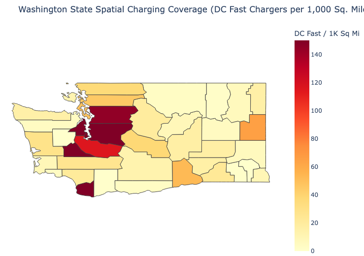
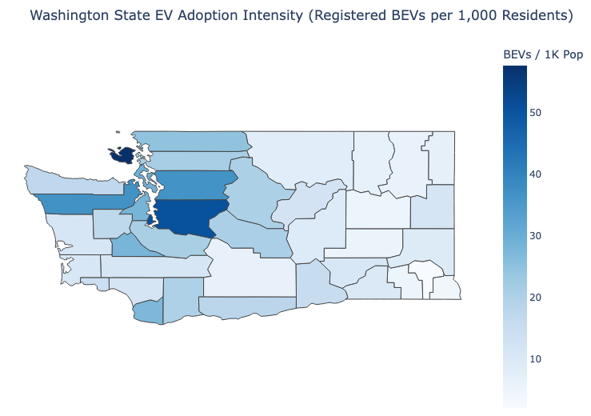
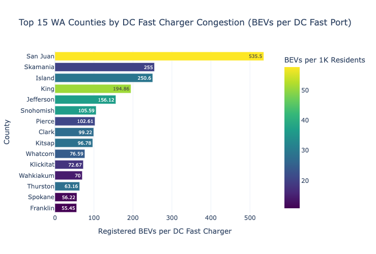

# Washington State EV Infrastructure & Spatial Analytics

An end-to-end Python ETL and spatial analytics pipeline evaluating electric vehicle (EV) adoption and charging network readiness across all 39 counties in Washington State.

## Project Overview
As EV adoption accelerates, public charging deployment often lags behind registration growth, particularly in rural and high-land-area corridors. This project synthesizes **241,238 cleaned BEV registration records**, **3,192 active public charging stations**, and **39 county demographic profiles** to quantify infrastructure bottlenecks and guide targeted capital allocation.

## Data Sources & ETL Pipeline
1. **WA State DOL EV Population Data (`data.wa.gov`):** Filtered active Washington Battery Electric Vehicles (BEVs), deduplicated vehicle IDs, and imputed missing electric ranges using model-level statistical means (`ev_cleaned.csv`).
2. **NREL Alternative Fuel Stations REST API:** Queried live public charging stations across Washington, imputed missing port counts, and mapped station ZIP codes to standardized counties using `pgeocode` (`cleaned_fuel_station.csv`).
3. **County Demographics (`BeautifulSoup`):** Scraped and standardized 2025 county population and land area (sq. mi.) tables from Wikipedia (`cleaned_counties.csv`).
4. **Spatial Integration (`integrated.csv`):** Merged all three sources at the county level to engineer three core readiness metrics:
   * **Congestion Pressure (`bevs_per_charger`):** Registered BEVs per public DC fast charger.
   * **Spatial Density (`dc_fast_per_1k_sq_mi`):** Public DC fast chargers per 1,000 square miles.
   * **Adoption Intensity (`bev_adoption_per_1k`):** Registered BEVs per 1,000 county residents.

## Key Findings
* **Zero-DC-Fast Blind Spot:** **Mason County** has **1,235 registered BEVs** (17.35 BEVs per 1K residents) but **0 public DC fast chargers** across 959 sq. miles.
* **High-Adoption Congestion:** Island and peninsula corridors face severe queuing pressure, led by **San Juan** (535.50 BEVs/DC port), **Skamania** (255.00), **Island** (250.60), and **King County** (194.86 BEVs/DC port across 119,059 BEVs).
* **Rural Range-Anxiety Corridors:** Washington's largest counties by land area—including **Okanogan** (5,268 sq. mi.; 3.61 DC ports/1K sq. mi.), **Ferry** (2,204 sq. mi.; 1.81), and **Stevens** (2,478 sq. mi.; 6.46)—face severe geographic gaps between fast-charging stations.

## Tech Stack
* **Python:** `pandas`, `NumPy`, `Plotly`, `BeautifulSoup4`, `pgeocode`, `requests`

## Visualizations

